# 2015 年全国硕士研究生入学考试计算机学科专业基础综合试题

> 按社区重排 PDF 的原生文字及页面图表转换；图表按原位置裁取，未调用 OCR。原文件及异文见根目录说明。

## 一、单项选择题

第 1～40 题，每题 2 分，共 80 分。每题只有一个选项符合题目要求。

### 第 1 题（2 分）

已知程序如下：

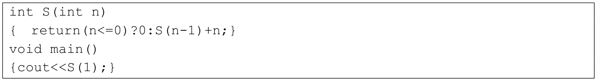

程序运行时使用栈来保存调用过程的信息，自栈底到栈顶保存的信息依次对应的是（　）。

A. main()→S(1)→S(0)

B. S(0)→S(1)→main() 

C. main()→S(0)→S(1) 

D. S(1)→S(0)→main()

### 第 2 题（2 分）

先序序列为a, b, c, d 的不同二叉树的个数是（　）。

A. 13

B. 14

C. 15

D. 16

### 第 3 题（2 分）

下列选项给出的是从根分别到达两个叶结点路径上的权值序列，能属于同一棵哈夫曼树的是（　）。

A. 24, 10, 5 和24, 10, 7

B. 24, 10, 5 和24, 12, 7

C. 24, 10, 10 和24, 14, 11

D. 24, 10, 5 和24, 14, 6

### 第 4 题（2 分）

现有一棵无重复关键字的平衡二叉树（AVL 树），对其进行中序遍历可得到一个降序序列。下列关于该平衡二叉树的叙述中，正确的是（　）。

A. 根结点的度一定为2

B. 树中最小元素一定是叶结点

C. 最后插入的元素一定是叶结点

D. 树中最大元素一定是无左子树

### 第 5 题（2 分）

设有向图G=(V，E)，顶点集V={v0, v1, v2, v3}，边集E={&lt;v0, v1&gt;，&lt;v0, v2&gt;，&lt;v0, v3&gt;, &lt;v1,v3&gt;}。若从顶点v0开始对图进行深度优先遍历，则可能得到的不同遍历序列个数是（　）。

A. 2

B. 3

C. 4

D. 5

### 第 6 题（2 分）

求下面带权图的最小（代价）生成树时，可能是克鲁斯卡（Kruskal)算法第2 次选中但不是普里姆(Prim)算法（从V4开始）第2 次选中的边是（　）。

A. (V1, V3)

B. (V1, V4)

C. (V2, V3)

D. (V3, V4)

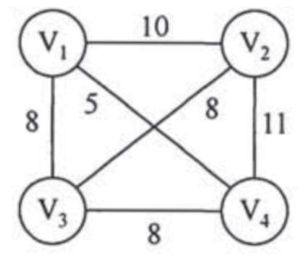

### 第 7 题（2 分）

下列选项中，不能构成折半查找中关键字比较序列的是（　）。

A. 500, 200, 450, 180

B. 500, 450, 200, 180

C. 180, 500, 200, 450

D. 180, 200, 500, 450

### 第 8 题（2 分）

己知字符串S 为“abaabaabacacaabaabcc”，模式串t 为“abaabc”。采用KMP 算法进行匹配，第一次出现“失配”（s[i] ≠ t[j]）时，i＝j＝5，下次开始匹配时，i 和j 的值分别是（　）。

A. i = 1, j = 0

B. i = 5, j = 0

C. i = 5, j = 2

D. i = 6, j = 2

### 第 9 题（2 分）

下列排序算法中，元素的移动次数与关键字的初始排列次序无关的是（　）。

A. 直接插入排序

B. 起泡排序

C. 基数排序

D. 快速排序

### 第 10 题（2 分）

已知小根堆为8, 15, 10, 21, 34, 16, 12，删除关键字8 之后需重建堆，在此过程中，关键字之间的比较次数是（　）。

A. 1

B. 2

C. 3

D. 4

### 第 11 题（2 分）

希尔排序的组内排序采用的是（　）。

A. 直接插入排序

B. 折半插入排序

C. 快速排序

D. 归并排序

### 第 12 题（2 分）

计算机硬件能够直接执行的是（　）。

I. 机器语言程序

II. 汇编语言程序

III. 硬件描述语言程序

A. 仅I

B. 仅I、II

C. 仅I、III

D. I、II、III

### 第 13 题（2 分）

由3 个“1”和5 个“0”组成的8 位二进制补码，能表示的最小整数是（　）。

A. －126

B. －125

C. －32

D. －3

### 第 14 题（2 分）

下列有关浮点数加减运算的叙述中，正确的是（　）。

I. 对阶操作不会引起阶码上溢或下溢

II. 右规和尾数舍入都可能引起阶码上溢

III. 左规时可能引起阶码下溢

IV. 尾数溢出时，结果不一定溢出

A. 仅II、III

B. 仅I、II、IV

C. 仅I、III、IV

D. I、II、III、IV

### 第 15 题（2 分）

假定主存地址为32 位，按字节编址，主存和Cache 之间采用直接映射方式，主存块大小为4 个字，每字32 位，采用回写（Write Back）方式，则能存放4K 字数据的Cache 的总容量的位数至少是

A. 146k

B. 147K

C. 148K

D. 158K

### 第 16 题（2 分）

假定编译器将赋值语句“x = x + 3;”转换为指令"add xaddr, 3”，其中xaddr 是x 对应的存储单元地址。若执行该指令的计算机采用页式虚拟存储管理方式，并配有相应的TLB，且Cache 使用直写（Write Through)方式，则完成该指令功能需要访问主存的次数至少是（　）。

A. 0

B. 1

C. 2

D. 3

### 第 17 题（2 分）

下列存储器中，在工作期间需要周期性刷新的是（　）。

A. SRAM

B. SDRAM

C. ROM

D. FLASH

### 第 18 题（2 分）

某计算机使用4 体交叉编址存储器，假定在存储器总线上出现的主存地址（十进制）序列为8005, 8006, 8007, 8008, 8001, 8002, 8003, 8004, 8000，则可能发生访存冲突的地址对是（　）。

A. 8004 和8008

B. 8002 和8007

C. 8001 和8008

D. 8000 和8004

### 第 19 题（2 分）

下列有关总线定时的叙述中，错误的是（　）。

A. 异步通信方式中，全互锁协议最慢

B. 异步通信方式中，非互锁协议的可靠性最差

C. 同步通信方式中，同步时钟信号可由各设备提供

D. 半同步通信方式中，握手信号的采样由同步时钟控制

### 第 20 题（2 分）

若磁盘转速为7200rpm，平均寻道时间为8ms，每个磁道包含1000 个扇区，则访问一个扇区的平均存取时间大约是（　）。

A. 8.1ms

B. 12.2ms

C. 16.3ms

D. 20.5ms

### 第 21 题（2 分）

在采用中断I/O 方式控制打印输出的情况下，CPU 和打印控制接囗中的I/O 端口之间交换的信息不可能是

A. 打印字符

B. 主存地址

C. 设备状态

D. 控制命令

### 第 22 题（2 分）

内部异常（内中断）可分为故障（fault）、陷阱（trap）和终止（abort）三类。下列有关内部异常的叙述中，错误的是（　）。

A. 内部异常的产生与当前执行指令相关

B. 内部异常的检测由CPU 内部逻辑实现

C. 内部异常的响应发生在指令执行过程中

D. 内部异常处理后返回到发生异常的指令继续执行

### 第 23 题（2 分）

处理外部中断时，应该由操作系统保存的是（　）。

A. 程序计数器（PC）的内容

B. 通用寄存器的内容

C. 块表（TLB）中的内容

D. Cache 中的内容

### 第 24 题（2 分）

假定下列指令己装入指令寄存器，则执行时不可能导致CPU 从用户态变为内核态（系统态）的是（　）。

A. DIV R0, R1; (R0) / (R1) →R0

B. INT n; 产生软中断

C. NOT R0; 寄存器R0 的内容取非

D. MOV R0, addr; 把地址addr 处的数据放入寄存器R0 中

### 第 25 题（2 分）

下列选项中，会导致进程从执行态变为就绪态的事件是（　）。

A. 执行P(wait)操作

B. 申请内存失败

C. 启动I/O 设备

D. 被高优先级进程抢占

### 第 26 题（2 分）

若系统S1 采用死锁避免方法，S2 采用死锁检测方法。下列叙述中，正确的是（　）。

I. S1 会限制用户申请资源的顺序，而S2 不会

II. S1 需要进程运行所需资源总量信息，而S2 不需要

III. S1 不会给可能导致死锁的进程分配资源，而S2 会

A. 仅I、II

B. 仅II、III

C. 仅I、III

D. I、II、III

### 第 27 题（2 分）

系统为某进程分配了4 个页框，该进程己访问的页号序列为2, 0, 2, 9, 3, 4, 2, 8, 2, 4, 8, 4, 5。若进程要访问的下一页的页号为7，依据LRU 算法，应淘汰页的页号是（　）。

A. 2

B. 3

C. 4

D. 8

### 第 28 题（2 分）

在系统内存中设置磁盘缓冲区的主要目的是（　）。

A. 减少磁盘I/O 次数

B. 减少平均寻道时间

C. 提高磁盘数据可靠性

D. 实现设备无关性

### 第 29 题（2 分）

在文件的索引结点中存放直接索引指针10 个，一级和二级索引指针各1 个。磁盘块大小为1KB，每个索引指针占4 字节。若某文件的索引结点己在内存中，则把该文件偏移量（按字节编址）为1234 和307400 处所在的磁盘块读入内存，需访问的磁盘块个数分别是（　）。

A. 1, 2

B. 1, 3

C. 2, 3

D. 2, 4

### 第 30 题（2 分）

在请求分页系统中，页面分配策略与页面置换策略不能组合使用的是（　）。

A. 可变分配，全局置换

B. 可变分配，局部置换

C. 固定分配，全局置换

D. 固定分配，局部置换

### 第 31 题（2 分）

文件系统用位图法表示磁盘空间的分配情况，位图存于磁盘的32、127 号块中，每个盘块占1024 字节，盘块和块内字节均从0 开始编号。假设要释放的盘块号为409612，则位图中要修改的位所在的盘块号和块内字节序号分别是（　）。

A. 81、1

B. 81、2

C. 82、1

D. 82、2

### 第 32 题（2 分）

某硬盘有200 个磁道（最外侧磁道号为0），磁道访问请求序列为130, 42, 180, 15, 199, 当前磁头位于第58 号磁道并从外侧向内侧移动。按照SCAN 调度方法处理完上述请求后，磁头移过的磁道数是（　）。

A. 208

B. 287

C. 325

D. 382

### 第 33 题（2 分）

通过POP3 协议接收邮件时，使用的传输层服务类型是（　）。

A. 无连接不可靠的数据传输服务

B. 无连接可靠的数据传输服务

C. 有连接不可靠的数据传输服务

D. 有连接可靠的数据传输服务

### 第 34 题（2 分）

使用两种编码方案对比特流01100111 进行编码的结果如下图所示，编码1 和编码2 分别是（　）。

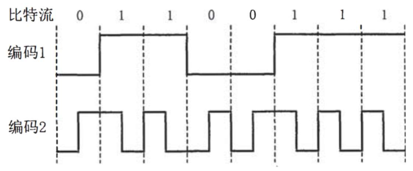

A. NRZ 和曼彻斯特编码

B. NRZ 和差分曼彻斯特编码

C. NRZI 和曼彻斯特编码

D. NRZI 和差分曼彻斯特编码

### 第 35 题（2 分）

主机甲通过128kbps 卫星链路，采用滑动窗口协议向主机乙发送数据，链路单向传播延迟为250ms，帧长为1000 字节。不考虑确认帧的开销，为使链路利用率不小于80%，帧序号的比特数至少是（　）。

A. 3

B. 4

C. 7

D. 8

### 第 36 题（2 分）

下列关于CSMA/CD 协议的叙述中，错误的是（　）。

A. 边发送数据帧，边检测是否发生冲突

B. 适用于无线网络，以实现无线链路共享

C. 需要根据网络跨距和数据传输速率限定最小帧长

D. 当信号传播延迟趋近0 时，信道利用率趋近100％

### 第 37 题（2 分）

下列关于交换机的叙述中，正确的是（　）。

A. 以太网交换机本质上是一种多端口网桥

B. 通过交换机互连的一组工作站构成一个冲突域

C. 交换机每个端口所连网络构成一个独立的广播域

D. 以太网交换机可实现采用不同网络层协议的网络互联

### 第 38 题（2 分）

某路由器的路由表如下表所示。

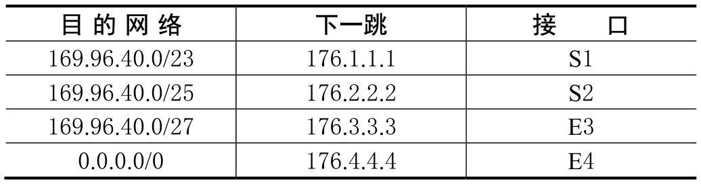

若路由器收到一个目的地址为169.96.40.5 的IP 分组，则转发该IP 分组的接口是（　）。

A. S1

B. S2

C. S3

D. S4

### 第 39 题（2 分）

主机甲和主机乙新建一个TCP 连接，甲的拥塞控制初始阈值为32KB，甲向乙始终以MSS=1KB大小的段发送数据，并一直有数据发送；乙为该连接分配16KB 接收缓存，并对每个数据段进行确认，忽略段传输延迟。若乙收到的数据全部存入缓存，不被取走，则甲从连接建立成功时刻起，未发送超时的情况下，经过4 个RTT 后，甲的发送窗口是（　）。

A. 1KB

B. 8KB

C. 16KB

D. 32KB

### 第 40 题（2 分）

某浏览器发出的请求报文如下：

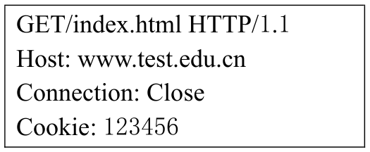

下列叙述中，错误的是（　）。

A. 该浏览器请求浏览index.html

B. index.html 存放在www.test.edu.cn 上

C. 该浏览器请求使用持续连接

D. 该浏览器曾经浏览过www.test.edu/cn

## 二、综合应用题

第 41～47 题，共 70 分。

### 第 41 题（15 分）

用单链表保存m 个整数，结点的结构为[data][link]，且| data |≤n （n 为正整数）。现要求设计一个时间复杂度尽可能高效的算法，对于链表中data 的绝对值相等的结点，仅保留第一次出现的结点而删除其余绝对值相等的结点。例如，若给定的单链表HEAD 如下：

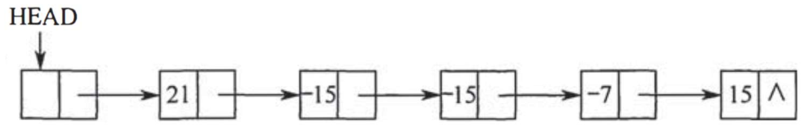

则删除结点后的HEAD 为

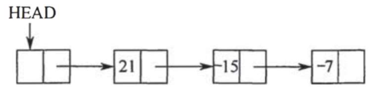

要求：

（1）给出算法的基本设计思想。

（2）使用C 或C++语言，给出单链表结点的数据类型定义。

（3）根据设计思想，采用C 或C++语言描述算法，关键之处给出注释。

（4）说明你所设计算法的时间复杂度和空间复杂度。

### 第 42 题（8 分）

已知含有5 个顶点的图G 如下图所示。

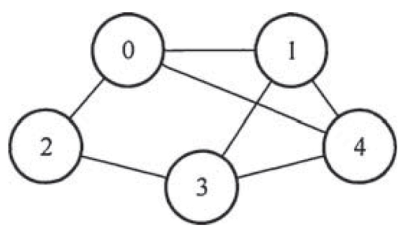

请回答下列问题：

（1）写出图G 的邻接矩阵A（行、列下标从0 开始）。

（2）求A2，矩阵A2中位于0 行3 列元素值的含义是什么？

（3）若已知具有n（n≥2）个顶点的图的邻接矩阵为则Bm（2≤m≤n）中非零元素的含义是什么？

### 第 43 题（13 分）

某16 位计算机的主存按字节编码，存取单位为16 位；采用16 位定长指令字格式；CPU 采用单总线结构，主要部分如下图所示。图中R0～R3 为通用寄存器：T 为暂存器；SR 为移位寄存器，可实现直送（mov）、左移一位（left）和右移一位（right）3 种操作，控制信号为SRop，SR 的输出由信号SRout 控制；ALU 可实现直送A（mova）、A 加B（add）、A 减B（sub）、A 与B（and）、A 或B（or）、非A（not）和A 加1（inc）7 种操作，控制信号为ALUop。

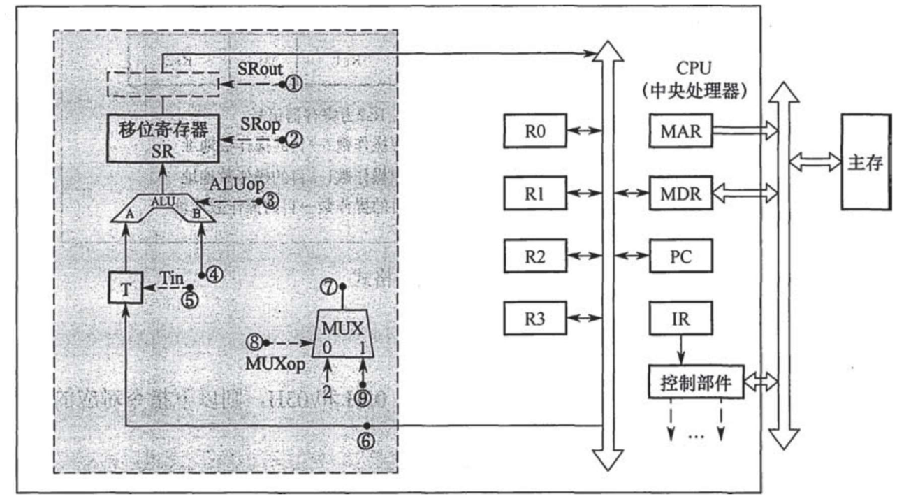

请回答下列问题。

（1）图中哪些寄存器是程序员可见的？为何要设置暂存器T？

（2）控制信号ALUop 和SRop 的位数至少各是多少？

（3）控制信号SRout 所控制部件的名称或作用是什么？

（4）端点①～⑨中，哪些端点须连接到控制部件的输出端？

（5）为完善单总线数据通路，需要在端点①～⑨中相应的端点之间添加必要的连线。写出连线的起点和终点，以正确表示数据的流动方向。

（6）为什么二路选择器MUX 的一个输入端是2？

### 第 44 题（10 分）

题43 中描述的计算机，其部分指令执行过程的控制信号如题44 图a 所示。

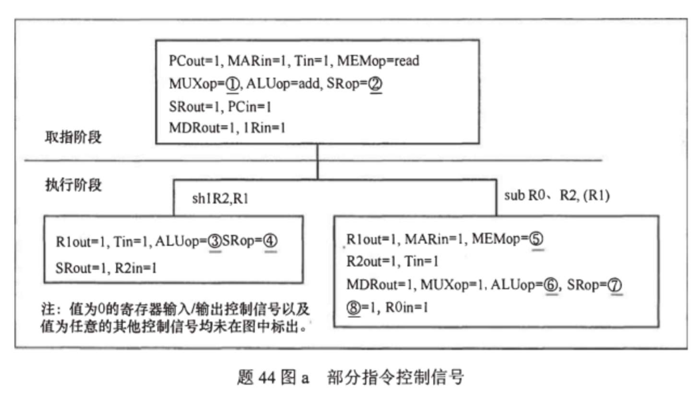

该机指令格式如题44 图b 所示，支持寄存器直接和寄存器间接两种寻址方式，寻址方式位分别为0 和1，通用寄存器R0～R3 的编号分别为0、1、2 和3。

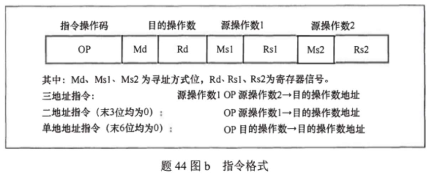

请回答下列问题。

（1）该机的指令系统最多可定义多少条指令？

（2）若inc、shl 和sub 指令的操作码分别为01H、02H 和03H，则以下指令对应的机器代码各是什么？

（3）假设寄存器x 的输入和输出控制信号分别为Xin 和Xout，其值为1 表示有效，为0 表示无效（如PCout=1 表示PC 内容送总线）；存储器控制信号为MEMop，用于控制存储器的读（read）和写（write）操作写出题图a 中标号①～⑧处的控制信号或控制信号的取值。

（4）指令“sub R1, R3, (R2)”和“inc R1”的执行阶段至少各需要多少个时钟周期？

### 第 45 题（9 分）

有A、B 两人通过信箱进行辩论，每个人都从自己的信箱中取得对方的问题。将答案和向对方提出的新问题组成一个邮件放入对方的邮箱中。假设A 的信箱最多放M 个邮件，B 的信箱最多放N 个邮件。初始时A 的信箱中有x 个邮件（0 &lt; x &lt; M），B 的信箱中有y 个（0 &lt; y &lt;N）。辩论者每取出一个邮件，邮件数减1。A 和B 两人的操作过程描述如下：CoBegin

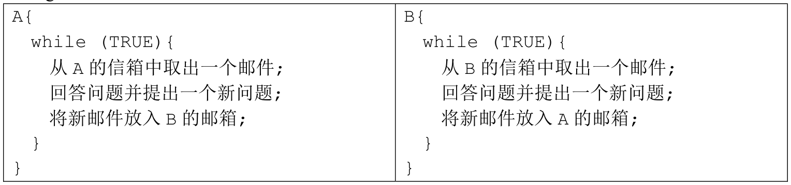

当信箱不为空时，辩论者才能从信箱中取邮件，否则需要等待。当信箱不满时，辩论者才能将新邮件放入信箱，否则需要等待。请添加必要的信号量和P、V（或wait、signal）操作，以实现上述过程的同步。要求写出完整过程，并说明信号量的含义和初值。

### 第 46 题（6 分）

某计算机系统按字节编址，采用二级页表的分页存储管理方式，虚拟地址格式如下所示：

请回答下列问题。

（1）页和页框的大小各为多少字节？进程的虚拟地址空间大小为多少页？

（2）假定页目录项和页表项均占4 字节，则进程的页目录和页表共占多少页？要求写出计算过程。

（3）若某指令周期内访问的虚拟地址为0100 0000H 和0111 2048H，则进行地址转换时共访问多少个二级页表？要求说明理由。

### 第 47 题（9 分）

某网络拓扑如下图所示，其中路由器内网接口、DHCP 服务器、www 服务器与主机1 均采用静态IP 地址配置，相关地址信息见图中标注；主机2～主机N 通过DHCP 服务器动态获取IP 地址等配置信息。

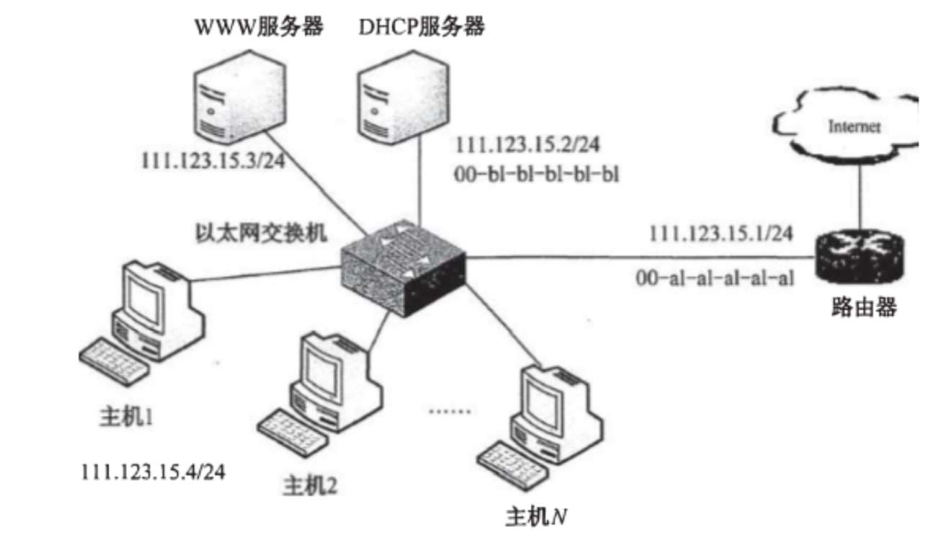

请回答下列问题。

（1）DHCP 服务器可为主机2～主机N 动态分配IP 地址的最大范围是什么？主机2 使用DHCP协议获取IP 地址的过程中，发送的封装DHCP Discover 报文的IP 分组的源IP 地址和目的IP 地址分别是什么？

（2）若主机2 的ARP 表为空，则该主机访问Internet 时，发出的第一个以太网帧的目的MAC地址是什么？封装主机2 发往Internet 的IP 分组的以太网帧的目的MAC 地址是什么？

（3）若主机1 的子网掩码和默认网关分别配置为255.255.255.0 和111.123.15.2，则该主机是否能访问WWW 服务器？是否能访问Internet？请说明理由。
