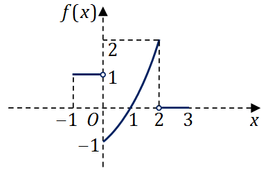
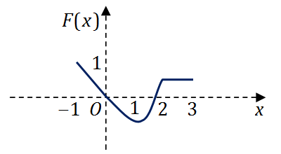
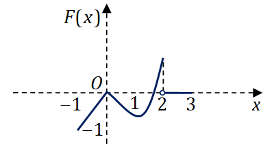
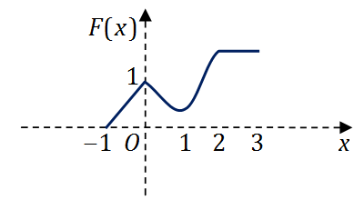
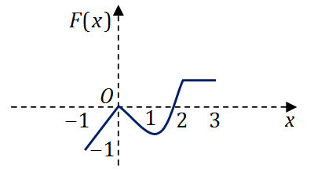

# 2009 年全国硕士研究生入学考试数学（二）试题

> 转换依据：吕剑瑞整理的原生 TeX；共用题已展开。来源与核对状态见根目录说明。

## 选择题

### 第 1 题

函数$f(x) = \frac{x - x^3}{\sin\pi x}$的可去间断点的个数为（　）

A. $1$．

B. $2$．

C. $3$．

D. 无穷多个．

### 第 2 题

当$x \to 0$时，$f(x) = x - \sin ax$与$g(x) = x^2\ln (1 - bx)$是等价无穷小，则（　）

A. $a = 1,b = - \frac{1}{6}$．

B. $a = 1,b = \frac{1}{6}$．

C. $a = - 1,b = - \frac{1}{6}$．

D. $a = - 1,b = \frac{1}{6}$．

### 第 3 题

设函数$z = f\left(x,y \right)$的全微分为$\,\mathrm{d}z = x\,\mathrm{d}x + y\,\mathrm{d}y$，则点$\left(0,0 \right)$（　）

A. 不是$f\left(x,y \right)$的连续点．

B. 不是$f\left(x,y \right)$的极值点．

C. 是$f\left(x,y \right)$的极大值点．

D. 是$f\left(x,y \right)$的极小值点．

### 第 4 题

设函数$f\left(x,y \right)$连续，
则$\int_1^2 \,\mathrm{d}x \int_x^2 f(x,y)\,\mathrm{d}y + \int_1^2 \,\mathrm{d}y \int_y^{4 - y} f(x,y)\,\mathrm{d}x =$（　）

A. $\int_1^2 \,\mathrm{d}x \int_1^{4 - x} f(x,y)\,\mathrm{d}y$．

B. $\int_1^2 \,\mathrm{d}x \int_x^{4 - x} f(x,y)\,\mathrm{d}y$．

C. $\int_1^2 \,\mathrm{d}y \int_1^{4 - y} f(x,y)\,\mathrm{d}x$．

D. $\int_1^2 \,\mathrm{d}y \int_y^2 f(x,y)\,\mathrm{d}x$．

### 第 5 题

若$f''(x)$不变号，且曲线$y = f(x)$在点$\left(1,1 \right)$上的曲率圆为$x^2 + y^2 = 2$，则$f(x)$在区间$\left(1,2 \right)$内（　）

A. 有极值点，无零点．

B. 无极值点，有零点．

C. 有极值点，有零点．

D. 无极值点，无零点．

### 第 6 题

设函数$y = f(x)$在区间$\left[- 1,3 \right]$上的图形为

则函数$F(x) = \int_0^x f(t)\,\mathrm{d}t$的图形为（　）

A. 

B. 

C. 

D. 

### 第 7 题

设$A$,$B$均为$2$阶矩阵，$A^*,B^*$分别为$A$,$B$的伴随矩阵，若$|A| = 2,|B| = 3$，
则分块矩阵$\begin{pmatrix}
  O & A \\
  B & O
\end{pmatrix}$的伴随矩阵为（　）

A. $\begin{pmatrix}
     O & 3B^* \\
  2A^* & O
\end{pmatrix}$．

B. $\begin{pmatrix}
     O & 2B^* \\
  3A^* & O
\end{pmatrix}$．

C. $\begin{pmatrix}
     O & 3A^* \\
  2B^* & O
\end{pmatrix}$．

D. $\begin{pmatrix}
     O & 2A^* \\
  3B^* & O
\end{pmatrix}$．

### 第 8 题

设$A$,$P$均为$3$阶矩阵，$P^T$为$P$的转置矩阵，且$P^T AP = \begin{pmatrix}
  1 & 0 & 0 \\
  0 & 1 & 0 \\
  0 & 0 & 2
\end{pmatrix}$，若$P = (\alpha_1,\alpha_2,\alpha_3)$，$Q = (\alpha_1 + \alpha_2,\alpha_2,\alpha_3)$，则$Q^T AQ$为（　）

A. $\begin{pmatrix}
  2 & 1 & 0 \\
  1 & 1 & 0 \\
  0 & 0 & 2
\end{pmatrix}$．

B. $\begin{pmatrix}
  1 & 1 & 0 \\
  1 & 2 & 0 \\
  0 & 0 & 2
\end{pmatrix}$．

C. $\begin{pmatrix}
  2 & 0 & 0 \\
  0 & 1 & 0 \\
  0 & 0 & 2
\end{pmatrix}$．

D. $\begin{pmatrix}
  1 & 0 & 0 \\
  0 & 2 & 0 \\
  0 & 0 & 2
\end{pmatrix}$．

## 填空题

### 第 9 题

曲线$\begin{cases}
  x = \int_0^{1\text{-} t} \mathrm{e}^{- u^2} \,\mathrm{d}u \\
  y = t^2\ln(2 - t^2)
\end{cases}$在$(0,0)$处的切线方程为 $\underline{\qquad}$．

### 第 10 题

已知$\int_{-\infty}^{+\infty}\mathrm{e}^{k|x|}\,\mathrm{d}x = 1$，则$k=$ $\underline{\qquad}$．

### 第 11 题

$\lim_{n \to \infty} \int_{0}^{1} \mathrm{e}^{- x}\sin nx\,\mathrm{d}x =$ $\underline{\qquad}$．

### 第 12 题

设$y = y(x)$是由方程$xy + \mathrm{e}^y = x + 1$确定的隐函数，
则$\frac{\mathrm{d}^2 y}{\mathrm{d} x^2}\Big|_{x = 0} =$ $\underline{\qquad}$．

### 第 13 题

函数$y = x^{2x}$在区间$(0,1]$上的最小值为 $\underline{\qquad}$．

### 第 14 题

设$\alpha ,\beta$为3维列向量，$\beta^{T}$为$\beta$的转置，
若矩阵$\alpha \beta^{T}$相似于$\begin{pmatrix}
  2 & 0 & 0 \\
  0 & 0 & 0 \\
  0 & 0 & 0
\end{pmatrix}$，则$\beta^{T}\alpha =$ $\underline{\qquad}$．

## 解答题

### 第 15 题（9 分）

求极限$\lim_{x \to 0} \frac{\left(1 - \cos x \right)\left[x - \ln(1 + \tan x) \right]}{\sin^4 x}$．

### 第 16 题（10 分）

计算不定积分$\int \ln \left(1 + \sqrt{\frac{1 + x}{x}} \right)\,\mathrm{d}x$（$x > 0$）．

### 第 17 题（10 分）

设$z=f(x+y,x-y,xy)$，其中$f$具有$2$阶连续偏导数，
求$\,\mathrm{d}z$与$\frac{\partial^2 z}{\partial x\partial y}$．

### 第 18 题（10 分）

设非负函数$y = y(x)$（$x \ge 0$）满足微分方程$xy'' - y' + 2 = 0$，
当曲线$y = y(x)$过原点时，其与直线$x = 1$及$y = 0$围成平面区域$D$的面积为$2$，
求$D$绕$y$轴旋转所得旋转体体积．

### 第 19 题（10 分）

计算二重积分$\iint_D (x - y)\,\mathrm{d}x\,\mathrm{d}y$，
其中$D = \left\{(x,y) \middle| (x - 1)^2 + (y - 1)^2 \le 2,y \ge x \right\}$．

### 第 20 题（12 分）

设$y = y(x)$是区间$(- \pi ,\pi)$内过点
$\left(- \frac{\pi}{\sqrt{2}},\frac{\pi}{\sqrt{2}} \right)$的光滑曲线，
当$- \pi < x < 0$时，曲线上任一点处的法线都过原点，
当$0 \le x < \pi$时，函数$y(x)$满足$y'' + y + x = 0$．求$y(x)$的表达式．

### 第 21 题（11 分）

（1）证明拉格朗日中值定理：若函数$f(x)$在$\left[a,b \right]$上连续，在$(a,b)$可导，
      则存在$\xi \in \left(a,b \right)$，使得$f(b) - f(a) = f'\left(\xi \right)(b - a)$．

（2）证明：若函数$f(x)$在$x = 0$处连续，在$\left(0,\delta \right)\left(\delta > 0 \right)$内可导，
      且$\lim_{x \to 0^+} f'(x) = A$，则$f'_+(0)$存在，且$f'_+(0) = A$．

### 第 22 题（11 分）

设$A = \begin{pmatrix}
   1 & -1 & -1 \\
  -1 &  1 & 1 \\
   0 & -4 & -2
\end{pmatrix}$,$\xi_1 = \begin{pmatrix}
  -1 \\
  1 \\
  -2
\end{pmatrix}$．

（1）求满足$A\xi_2 = \xi_1,A^2\xi_3 = \xi_1$的所有向量$\xi_2,\xi_3$；

（2）对(I)中的任意向量$\xi_2,\xi_3$，证明$\xi_1,\xi_2,\xi_3$线性无关．

### 第 23 题（11 分）

设二次型$f\left(x_1,x_2,x_3 \right) = ax_1^2 + ax_2^2 + (a - 1)x_3^2 + 2x_1x_3 - 2x_2x_3$．

（1）求二次型$f$的矩阵的所有特征值；

（2）若二次型$f$的规范形为$y_1^2 + y_2^2$，求$a$的值．
