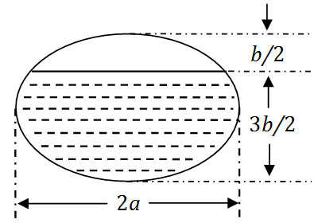

# 2010 年全国硕士研究生入学考试数学（二）试题

> 转换依据：吕剑瑞整理的原生 TeX；共用题已展开。来源与核对状态见根目录说明。

## 选择题

### 第 1 题

函数$f(x) = \frac{x^2 - x}{x^2 - 1}\sqrt{1 + \frac{1}{x^2}}$的无穷间断点的个数为（　）

A. $0$．

B. $1$．

C. $2$．

D. $3$．

### 第 2 题

设$y_1,y_2$是一阶线性非齐次微分方程$y' + p(x)y = q(x)$的两个特解，
若常数$\lambda ,\mu$使$\lambda y_1 + \mu y_2$是该方程的解，
$\lambda y_1 - \mu y_2$是该方程对应的齐次方程的解，则（　）

A. $\lambda = \frac{1}{2},\mu = \frac{1}{2}$．

B. $\lambda = - \frac{1}{2},\mu = - \frac{1}{2}$．

C. $\lambda = \frac{2}{3},\mu = \frac{1}{3}$．

D. $\lambda = \frac{2}{3},\mu = \frac{2}{3}$．

### 第 3 题

曲线$y = x^2$与曲线$y = a\ln x$（$a \ne 0$）相切，则$a =$（　）

A. $4\mathrm{e}$．

B. $3\mathrm{e}$．

C. $2\mathrm{e}$．

D. $\mathrm{e}$．

### 第 4 题

设$m,n$是正整数，则反常积分$\int_0^1 \frac{\sqrt[m]{\ln^2(1 - x)}}{\sqrt[n]{x}}\,\mathrm{d}x$的收敛性（　）

A. 仅与$m$的取值有关．

B. 仅与$n$的取值有关．

C. 与$m,n$取值都有关．

D. 与$m,n$取值都无关．

### 第 5 题

设函数$z = z(x,y)$由方程$F\left(\frac{y}{x},\frac{z}{x} \right) = 0$确定，其中$F$为可微函数，
且$F'_2 \ne 0$，则$x\frac{\partial z}{\partial x} + y\frac{\partial z}{\partial y} =$（　）

A. $x$．

B. $z$．

C. $- x$．

D. $- z$．

### 第 6 题

$\lim_{n\to\infty} \sum_{i=1}^n \sum_{j=1}^n \frac{n}{(n+i)\left(n^2 + j^2 \right)} =$（　）

A. $\int_0^1 \,\mathrm{d}x\int_0^x \frac{1}{(1 + x)\left(1 + y^2 \right)} \,\mathrm{d}y$．

B. $\int_0^1 \,\mathrm{d}x\int_0^x \frac{1}{(1 + x)\left(1 + y \right)} \,\mathrm{d}y$．

C. $\int_0^1 \,\mathrm{d}x\int_0^1 \frac{1}{(1 + x)\left(1 + y \right)} \,\mathrm{d}y$．

D. $\int_0^1 \,\mathrm{d}x\int_0^1 \frac{1}{(1 + x)\left(1 + y^2 \right)} \,\mathrm{d}y$．

### 第 7 题

设向量组Ⅰ：$\alpha_1,\alpha_2, \cdots ,\alpha_r$可由向量组Ⅱ：$\beta_1,\beta_2, \cdots ,\beta_s$线性表示，
下列命题正确的是（　）

A. 若向量组Ⅰ线性无关，则$r \le s$．

B. 若向量组Ⅰ线性相关，则$r > s$．

C. 若向量组Ⅱ线性无关，则$r \le s$．

D. 若向量组Ⅱ线性相关，则$r > s$．

### 第 8 题

设$A$为$4$阶实对称矩阵，且$A^2 + A = O$，若$A$的秩为$3$，则$A$相似于（　）

A. $\begin{pmatrix}
  1 &   &   & \\
    & 1 &   & \\
    &   & 1 & \\
    &   &   & 0
\end{pmatrix}$．

B. $\begin{pmatrix}
  1 &   &    & \\
    & 1 &    & \\
    &   & -1 & \\
    &   &    & 0
\end{pmatrix}$．

C. $\begin{pmatrix}
  1 &    &    & \\
    & -1 &    & \\
    &    & -1 & \\
    &    &    & 0
\end{pmatrix}$．

D. $\begin{pmatrix}
  -1 &    &    & \\
     & -1 &    & \\
     &    & -1 & \\
     &    &    & 0
\end{pmatrix}$．

## 填空题

### 第 9 题

$3$阶常系数线性齐次微分方程$y''' - 2y'' + y' - 2y = 0$的通解为$y =$ $\underline{\qquad}$．

### 第 10 题

曲线$y = \frac{2x^3}{x^2 + 1}$的渐近线方程为 $\underline{\qquad}$．

### 第 11 题

函数$y = \ln(1 - 2x)$在$x = 0$处的$n$阶导数$y^{(n)}(0) =$ $\underline{\qquad}$．

### 第 12 题

当$0 \le \theta \le \pi$时，对数螺线$r = \mathrm{e}^{\theta}$的弧长为 $\underline{\qquad}$．

### 第 13 题

已知一个长方形的长$l$以$2\text{cm/s}$的速率增加，宽$w$以$3\text{cm/s}$的速率增加．
则当$l = 12\text{cm}$，$w = 5\text{cm}$时，它的对角线增加的速率为 $\underline{\qquad}$．

### 第 14 题

设$A,B$为$3$阶矩阵，且$|A| = 3$，$|B| = 2$，$\left| A^{-1} + B \right| = 2$，
则$\left| A + B^{-1} \right|$= $\underline{\qquad}$．

## 解答题

### 第 15 题（10 分）

求函数$f(x) = \int_1^{x^2} \left(x^2 - t \right) \mathrm{e}^{- t^2} \,\mathrm{d}t$的单调区间与极值．

### 第 16 题（10 分）

（1）比较$\int_0^1 |\ln t|[\ln(1+t)]^n\,\mathrm{d}t$
与$\int_0^1 t^n |\ln t|\,\mathrm{d}t$（$n=1,2,\cdots$）的大小，说明理由；

（2）记$u_n = \int_0^1 |\ln t|[\ln(1+t)]^n\,\mathrm{d}t$（$n=1,2,\cdots$），求极限$\lim_{n\to\infty} u_n$．

### 第 17 题（10 分）

设函数$y = f(x)$由参数方程$\begin{cases}
  x = 2t + t^2 \\
  y = \psi(t)
\end{cases}(t > - 1)$所确定，其中$\psi (t)$具有$2$阶导数，且$\psi (1) = \frac{5}{2}$，$\psi'(1) = 6$．
已知$\frac{\mathrm{d}^2y}{\,\mathrm{d}x^2} = \frac{3}{4(1 + t)}$，求函数$\psi (t)$．

### 第 18 题（10 分）

一个高为$l$的柱体形贮油罐，底面是长轴为$2a$，短轴为$2b$的椭圆．
现将贮油罐平放，当油罐中油面高度为$\frac{3}{2}b$时（如图），计算油的质量．

（长度单位为$\text{m}$，质量单位为$\text{kg}$，油的密度为常数$\rho\text{kg/m}^3$）

### 第 19 题（11 分）

设函数$u = f(x,y)$具有二阶连续偏导数，且满足等式
$4\frac{\partial^2 u}{\partial x^2} + 12\frac{\partial^2 u}{\partial x\partial y} + 5\frac{\partial^2 u}{\partial y^2} = 0$．
确定$a$,$b$的值，使等式在变换$\xi = x + ay,\eta = x + by$下化简为$\frac{\partial^2 u}{\partial \xi \partial \eta} = 0$．

### 第 20 题（10 分）

计算二重积分
$$I = \iint_D r^2\sin \theta\sqrt{1 - r^2\cos 2\theta} \,\mathrm{d}r\mathrm{d}\theta,$$
其中$D=\left\{(r,\theta)\middle|0 \le r \le \sec \theta ,0 \le \theta \le \frac{\pi}{4} \right\}$．

### 第 21 题（10 分）

设函数$f(x)$在闭区间$[0,1]$上连续，在开区间$(0,1)$内可导，
且$f(0) = 0$, $f(1) = \frac{1}{3}$．证明：存在$\xi \in \left(0,\frac{1}{2}\right)$,
$\eta \in \left(\frac{1}{2},1\right)$，使得$f'(\xi) + f'(\eta) = \xi^2 + \eta^2$．

### 第 22 题（11 分）

设$A = \begin{pmatrix}
  \lambda & 1           & 1 \\
  0       & \lambda - 1 & 0 \\
  1       & 1           & \lambda
\end{pmatrix}$, $b = \begin{pmatrix}
  a \\
  1 \\
  1
\end{pmatrix}$，已知线性方程组$Ax = b$存在两个不同的解．

（1）求$\lambda$, $a$；

（2）求方程组$Ax = b$的通解．

### 第 23 题（11 分）

设$A = \begin{pmatrix}
   0 & -1 & 4 \\
  -1 &  3 & a \\
   4 &  a & 0
\end{pmatrix}$，正交矩阵$Q$使得$Q^T AQ$为对角矩阵，
若$Q$的第$1$列为$\frac{1}{\sqrt{6}}(1,2,1)^T$，求$a$, $Q$．
