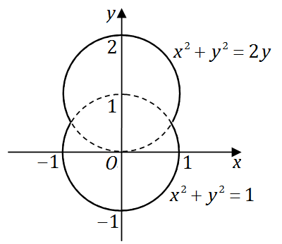

# 2011 年全国硕士研究生入学考试数学（二）试题

> 转换依据：吕剑瑞整理的原生 TeX；共用题已展开。来源与核对状态见根目录说明。

## 选择题

### 第 1 题

已知当$x \to 0$时，$f(x) = 3\sin x - \sin 3x$与$cx^k$是等价无穷小，则（　）

A. $k = 1,c = 4$．

B. $k = 1,c = - 4$．

C. $k = 3,c = 4$．

D. $k = 3,c = - 4$．

### 第 2 题

已知$f(x)$在$x = 0$处可导，且$f(0) = 0$，
则$\lim_{x \to 0} \frac{x^2 f(x) - 2f\left(x^3 \right)}{x^3} =$（　）

A. $- 2f'(0)$．

B. $- f'(0)$．

C. $f'(0)$．

D. $0$．

### 第 3 题

函数$f(x) = \ln \left| (x - 1)(x - 2)(x - 3) \right|$的驻点个数为（　）

A. $0$．

B. $1$．

C. $2$．

D. $3$．

### 第 4 题

微分方程$y'' - \lambda^2 y = \mathrm{e}^{\lambda x} + \mathrm{e}^{- \lambda x}$（$\lambda > 0$）的特解形式为（　）

A. $a(\mathrm{e}^{\lambda x} + \mathrm{e}^{- \lambda x})$．

B. $ax(\mathrm{e}^{\lambda x} + \mathrm{e}^{- \lambda x})$．

C. $x(a\mathrm{e}^{\lambda x} + b\mathrm{e}^{- \lambda x})$．

D. $x^2(a\mathrm{e}^{\lambda x} + b\mathrm{e}^{- \lambda x})$．

### 第 5 题

设函数$f(x)$具有二阶连续导数，且$f(x) > 0$，$f'(0) = 0$，
则函数$z = f(x)\ln f(y)$在点$(0,0)$处取得极小值的一个充分条件是（　）

A. $f(0) > 1$，$f''(0) > 0$．

B. $f(0) > 1$，$f''(0) < 0$．

C. $f(0) < 1$，$f''(0) > 0$．

D. $f(0) < 1$，$f''(0) < 0$．

### 第 6 题

设$I = \int_{0}^{\frac{\pi}{4}}\ln\sin x\,\mathrm{d}x$，$J = \int_{0}^{\frac{\pi}{4}}\ln\cot x\,\mathrm{d}x$，
$K = \int_{0}^{\frac{\pi}{4}}\ln\cos x\,\mathrm{d}x$，则$I,\;J,\;K$的大小关系是（　）

A. $I < J < K$．

B. $I < K < J$．

C. $J < I < K$．

D. $K < J < I$．

### 第 7 题

设$A$为$3$阶矩阵，将$A$的第$2$列加到第$1$列得矩阵$B$，
再交换$B$的第$2$行与第$3$行得单位矩阵，记$P_1 = \begin{pmatrix}
  1 & 0 & 0 \\
  1 & 1 & 0 \\
  0 & 0 & 1
\end{pmatrix}$，$P_2 = \begin{pmatrix}
  1 & 0 & 0 \\
  0 & 0 & 1 \\
  0 & 1 & 0
\end{pmatrix}$，则$A =$（　）

A. $P_1P_2$．

B. $P_1^{-1}P_2$．

C. $P_2P_1$．

D. $P_2 P_1^{-1}$．

### 第 8 题

设$A = (\alpha_1,\alpha_2,\alpha_3,\alpha_4)$是$4$阶矩阵，$A^*$为$A$的伴随矩阵，
若$(1,0,1,0)^T$是方程组$Ax = 0$的一个基础解系，则$A^* x = 0$的基础解系可为（　）

A. $\alpha_1,\alpha_3$．

B. $\alpha_1,\alpha_2$．

C. $\alpha_1,\alpha_2,\alpha_3$．

D. $\alpha_2,\alpha_3,\alpha_4$．

## 填空题

### 第 9 题

$\lim_{x \to 0} \left(\frac{1 + 2^x}{2} \right)^{\frac{1}{x}} =$ $\underline{\qquad}$．

### 第 10 题

微分方程$y' + y = \mathrm{e}^{- x}\cos x$满足条件$y(0) = 0$的解为$y =$ $\underline{\qquad}$．

### 第 11 题

曲线$y = \int_0^x \tan t\,\mathrm{d}t$（$0 \le x \le \frac{\pi}{4}$）的弧长$s =$ $\underline{\qquad}$．

### 第 12 题

设函数$f(x) = \begin{cases}
  \lambda \mathrm{e}^{- \lambda x}, & x > 0, \\
                         0, & x \le 0,
\end{cases}$ $\lambda > 0$，则$\int_{-\infty}^{+\infty} xf(x)\,\mathrm{d}x =$ $\underline{\qquad}$．

### 第 13 题

设平面区域$D$由直线$y = x$，圆$x^2 + y^2 = 2y$及$y$轴围成，则二重积分$\iint_D xy\mathrm{d}\sigma =$ $\underline{\qquad}$．

### 第 14 题

二次型$f(x_1,x_2,x_3) = x_{1}^{2} + 3x_2^2 + x_3^2 + 2x_1x_2 + 2x_1x_3 + 2x_2x_3$，
则$f$的正惯性指数为 $\underline{\qquad}$．

## 解答题

### 第 15 题（10 分）

已知函数$F(x) = \frac{\int_0^x \ln(1 + t^2)\,\mathrm{d}t}{x^a}$，
设$\!\!\lim_{x \to +\infty}\!\!\! F(x) = \!\lim_{x \to 0^+}\! F(x) = 0$，试求$a$的取值范围．

### 第 16 题（11 分）

设函数$y = y(x)$由参数方程$\begin{cases}
  x = \frac{1}{3}t^3 + t + \frac{1}{3}, \\
  y = \frac{1}{3}t^3 - t + \frac{1}{3},
\end{cases}$确定，求$y = y(x)$的极值和曲线$y = y(x)$的凹凸区间及拐点．

### 第 17 题（9 分）

设函数$z = f(xy,yg(x))$，其中函数$f$具有二阶连续偏导数，
函数$g(x)$可导且在$x = 1$处取得极值$g(1) = 1$，
求$\left. \frac{\partial^2 z}{\partial x\partial y} \right|_{\substack{
  x = 1 \\
  y = 1
}}$．

### 第 18 题（10 分）

设函数$y(x)$具有二阶导数，且曲线$l:y = y(x)$与直线$y = x$相切于原点，
记$\alpha$为曲线$l$在点$(x,y)$处切线的倾角，若$\frac{\mathrm{d}\alpha}{\,\mathrm{d}x} = \frac{\,\mathrm{d}y}{\,\mathrm{d}x}$，求$y(x)$的表达式．

### 第 19 题（10 分）

（1）证明：对任意的正整数$n$，都有$\frac{1}{n + 1} < \ln \left(1 + \frac{1}{n} \right) < \frac{1}{n}$成立．

（2）设$a_n = 1 + \frac{1}{2} + \cdots + \frac{1}{n} - \ln n$（$n = 1,2, \cdots$），
证明数列$\left\{a_n \right\}$收敛．

### 第 20 题（11 分）

一容器的内侧是由图中曲线绕$y$轴旋转一周而成的曲面，
该曲线由$x^2 + y^2 = 2y$（$y \ge \frac{1}{2}$）与$x^2 + y^2 = 1$（$y \le \frac{1}{2}$）连接而成．

（1）求容器的容积；

（2）若将容器内盛满的水从容器顶部全部抽出，至少需要做多少功？

（长度单位：$\text{m}$，重力加速度为$g\text{m/s}^2$，水的密度为$10^3\text{kg/m}^3$．）

### 第 21 题（11 分）

已知函数$f(x,y)$具有二阶连续偏导数，且
$$f(1,y) = 0,\quad f(x,1) = 0,\quad \iint_D f(x,y)\,\mathrm{d}x\,\mathrm{d}y = a,$$
其中$D = \left\{(x,y)\middle|0 \le x \le 1,0 \le y \le 1 \right\}$，
计算二重积分$I = \iint_D xy f''_{xy}(x,y)\,\mathrm{d}x\,\mathrm{d}y$．

### 第 22 题（11 分）

设向量组$\alpha_1 = (1,0,1)^T$, $\alpha_2 = (0,1,1)^T$, $\alpha_3 = (1,3,5)^T$
不能由向量组$\beta_1 = (1,1,1)^T$, $\beta_2 = (1,2,3)^T$, $\beta_3 = (3,4,a)^T$线性表示．

（1）求$a$的值；

（2）将$\beta_1,\beta_2,\beta_3$用$\alpha_1,\alpha_2,\alpha_3$线性表示．

### 第 23 题（11 分）

$A$为三阶实对称矩阵，$A$的秩$r(A) = 2$，且$A\begin{pmatrix}
   1 & 1 \\
   0 & 0 \\
  -1 & 1
\end{pmatrix} = \begin{pmatrix}
  -1 & 1 \\
   0 & 0 \\
   1 & 1
\end{pmatrix}$．

（1）求$A$的特征值与特征向量；

（2）求矩阵$A$．
