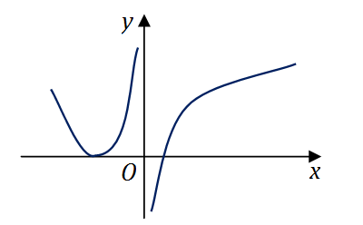

# 2015 年全国硕士研究生入学考试数学（二）试题

> 转换依据：吕剑瑞整理的原生 TeX；共用题已展开。来源与核对状态见根目录说明。

## 选择题

### 第 1 题

下列反常积分收敛的是（　）

A. $\int_2^{+\infty} \frac{1}{\sqrt{x}}\,\mathrm{d}x$．

B. $\int_2^{+\infty} \frac{\ln x}{x}\,\mathrm{d}x$．

C. $\int_2^{+\infty} \frac{1}{x\ln x}\,\mathrm{d}x$．

D. $\int_2^{+\infty} \frac{x}{\mathrm{e}^x}\,\mathrm{d}x$．

### 第 2 题

函数$f(x) = \lim_{t \to 0} \left(1 + \frac{\sin t}{x} \right)^{\frac{x^2}{t}}$
在$(-\infty , +\infty)$内（　）

A. 连续．

B. 有可去间断点．

C. 有跳跃间断点．

D. 有无穷间断点．

### 第 3 题

设函数$f(x) = \begin{cases}
  x^{\alpha}\cos \frac{1}{x^{\beta}}, & x > 0 \\
                                   0, & x \le 0
\end{cases}$（$\alpha > 0,\beta > 0$），若$f'(x)$在$x = 0$处连续，则（　）

A. $\alpha - \beta > 1$．

B. $0 < \alpha - \beta \le 1$．

C. $\alpha - \beta > 2$．

D. $0 < \alpha - \beta \le 2$．

### 第 4 题

设函数$f(x)$在$\left(-\infty , +\infty \right)$内连续，
其中二阶导数$f''(x)$的图形如图所示，则曲线$y = f(x)$的拐点的个数为（　）

A. $0$．

B. $1$．

C. $2$．

D. $3$．

### 第 5 题

设函数$f\left(u,v \right)$满足$f\left(x + y,\frac{y}{x}\right) = x^2 - y^2$，
则$\frac{\partial f}{\partial u}\big|_{\substack{
  u = 1 \\
  v = 1
}}$与$\frac{\partial f}{\partial v}\big|_{\substack{
  u = 1 \\
  v = 1
}}$依次是（　）

A. $\frac{1}{2},0$．

B. $0,\frac{1}{2}$．

C. $- \frac{1}{2},0$．

D. $0, - \frac{1}{2}$．

### 第 6 题

设$D$是第一象限由曲线$2xy = 1$，$4xy = 1$，与直线$y = x$，$y = \sqrt{3} x$围成的平面区域，
函数$f(x,y)$在$D$上连续，则$\iint_D f(x,y)\,\mathrm{d}x\,\mathrm{d}y =$（　）

A. $\int_{\frac{\pi}{4}}^{\frac{\pi}{3}} \mathrm{d}\theta
       \int_{\frac{1}{2\sin 2\theta}}^{\frac{1}{\sin 2\theta}} f(r\cos \theta ,r\sin \theta)r\,\mathrm{d}r$．

B. $\int_{\frac{\pi}{4}}^{\frac{\pi}{3}} \mathrm{d}\theta
       \int_{\frac{1}{\sqrt{2\sin 2\theta}}}^{\frac{1}{\sqrt{\sin 2\theta}}}
            f(r\cos \theta ,r\sin \theta)r\,\mathrm{d}r$．

C. $\int_{\frac{\pi}{4}}^{\frac{\pi}{3}} \mathrm{d}\theta
       \int_{\frac{1}{2\sin 2\theta}}^{\frac{1}{\sin 2\theta}} f(r\cos \theta ,r\sin \theta)\,\mathrm{d}r$．

D. $\int_{\frac{\pi}{4}}^{\frac{\pi}{3}} \mathrm{d}\theta
       \int_{\frac{1}{\sqrt{2\sin 2\theta}}}^{\frac{1}{\sqrt{\sin 2\theta}}}
            f(r\cos \theta ,r\sin \theta)\,\mathrm{d}r$．

### 第 7 题

设矩阵$A = \begin{pmatrix}
  1 & 1 & 1 \\
  1 & 2 & a \\
  1 & 4 & a^2
\end{pmatrix}$，$b = \begin{pmatrix}
  1 \\
  d \\
  d^2
\end{pmatrix}$．若集合$\Omega = \left\{1,\left. 2 \right\} \right.$，
则线性方程组$Ax = b$有无穷多解的充分必要条件为（　）

A. $a \notin \Omega ,d \notin \Omega$．

B. $a \notin \Omega ,d \in \Omega$．

C. $a \in \Omega ,d \notin \Omega$．

D. $a \in \Omega ,d \in \Omega$．

### 第 8 题

设二次型$f\left(x_1,x_2,x_3 \right)$在正交变换为$x = Py$下的标准形为$2y_1^2 + y_2^2 - y_3^2$，
其中$P = \left(e_1,e_2,e_3 \right)$，若$Q = \left(e_1, - e_3,e_2 \right)$，
则$f\left(x_1,x_2,x_3 \right)$在正交变换$x = Qy$下的标准形为（　）

A. $2y_1^2 - y_2^2 + y_3^2$．

B. $2y_1^2 + y_2^2 - y_3^2$．

C. $2y_1^2 - y_2^2 - y_3^2$．

D. $2y_1^2 + y_2^2 + y_3^2$．

## 填空题

### 第 9 题

设$\begin{cases}
  x = \arctan t, \\
  y = 3t + t^3,
\end{cases}$则$\frac{\mathrm{d}^2y}{\,\mathrm{d}x^2}\big|_{t = 1} =$ $\underline{\qquad}$．

### 第 10 题

函数$f(x) = x^2 \cdot 2^x$在$x = 0$处的$n$阶导数$f^{(n)}(0) =$ $\underline{\qquad}$．

### 第 11 题

设$f(x)$连续，$\varphi (x) = \int_0^{x^2} x f(t)\,\mathrm{d}t$，
若$\varphi (1) = 1$，$\varphi'(1) = 5$，则$f(1) =$ $\underline{\qquad}$．

### 第 12 题

设函数$y = y(x)$是微分方程$y'' + y' - 2y = 0$的解，且在$x = 0$处$y(x)$取得极值$3$，则$y(x)$= $\underline{\qquad}$．

### 第 13 题

若函数$z = z(x,y)$由方程$\mathrm{e}^{x + 2y + 3z} + xyz = 1$确定，
则$\,\mathrm{d}z\big|_{(0,0)} =$ $\underline{\qquad}$．

### 第 14 题

若$3$阶矩阵$A$的特征值为$2, - 2,1$，$B = A^2 - A + E$，
其中$E$为$3$阶单位阵，则行列式$|B| =$ $\underline{\qquad}$．

## 解答题

### 第 15 题（10 分）

设函数$f(x) = x + a\ln(1 + x) + bx\sin x$，$g(x) = kx^3$，
若$f(x)$与$g(x)$在$x \to 0$是等价无穷小，求$a,b,k$的值．

### 第 16 题（10 分）

设$A > 0$，$D$是由曲线段$y = A\sin x$（$0 \le x \le \frac{\pi}{2}$）
及直线$y = 0$，$x = \frac{\pi}{2}$所围成的平面区域，
$V_1$，$V_2$分别表示$D$绕$x$轴与绕$y$轴旋转成旋转体的体积，若$V_1 = V_2$，求$A$的值．

### 第 17 题（11 分）

已知函数$f(x,y)$满足
$$f''_{xy}(x,y) = 2(y + 1)\mathrm{e}^x,\quad f'_x(x,0) = (x + 1)\mathrm{e}^x,\quad f(0,y) = y^2 + 2y.$$
求$f(x,y)$的极值．

### 第 18 题（10 分）

计算二重积分$\iint_D x(x + y)\,\mathrm{d}x\,\mathrm{d}y$，
其中$D = \left\{(x,y) \middle| x^2 + y^2 \le 2,y \ge x^2 \right\}$．

### 第 19 题（11 分）

已知函数$f(x) = \int_x^1 \sqrt{1 + t^2} \,\mathrm{d}t + \int_1^{x^2} \sqrt{1 + t} \,\mathrm{d}t$，求$f(x)$的零点个数．

### 第 20 题（10 分）

已知高温物体置于低温介质中，任一时刻该物体温度对时间的变化率与该时刻物体和介质的温差成正比，
现将一初始温度为$120^{\circ}C$的物体在$20^{\circ}C$的恒温介质中冷却，$30$min后该物体降至$30^{\circ}C$，
若要将该物体的温度继续降至$21^{\circ}C$，还需冷却多长时间？

### 第 21 题（10 分）

已知函数$f(x)$在区间$[a,+\infty)$上具有$2$阶导数，
$f(a) = 0$，$f'(x) > 0$，$f''(x) > 0$．设$b > a$，
曲线$y = f(x)$在点$(b,f(b))$处的切线与$x$轴的交点是$(x_0,0)$，
证明$a < x_0 < b$．

### 第 22 题（11 分）

设矩阵$A = \begin{pmatrix}
  a & 1 & 0 \\
  1 & a & -1 \\
  0 & 1 & a
\end{pmatrix}$且$A^3 = O$．

（1）求$a$的值；

（2）若矩阵$X$满足$X - XA^2 - AX + AX A^2 = E$，$E$为$3$阶单位阵，求$X$．

### 第 23 题（11 分）

设矩阵$A = \begin{pmatrix}
   0 &  2 & -3 \\
  -1 &  3 & -3 \\
   1 & -2 & a
\end{pmatrix}$相似于矩阵$B = \begin{pmatrix}
  1 & -2 & 0 \\
  0 &  b & 0 \\
  0 &  3 & 1
\end{pmatrix}$．

（1）求$a,b$的值；

（2）求可逆矩阵$P$，使$P^{-1} AP$为对角矩阵．
