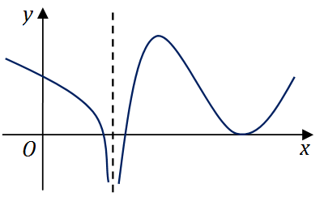

# 2016 年全国硕士研究生入学考试数学（二）试题

> 转换依据：吕剑瑞整理的原生 TeX；共用题已展开。来源与核对状态见根目录说明。

## 选择题

### 第 1 题

设$a_1 = x(\cos \sqrt{x} - 1)$，$a_2 = \sqrt{x} \ln(1 + \sqrt[3]{x})$，$a_3 = \sqrt[3]{x + 1} - 1$．
当$x \to 0^+$时，以上$3$个无穷小量按照从低阶到高阶的排序是（　）

A. $a_1,a_2,a_3$．

B. $a_2,a_3,a_1$．

C. $a_2,a_1,a_3$．

D. $a_3,a_2,a_1$．

### 第 2 题

已知函数$f(x) = \begin{cases}
  2(x - 1), & x < 1, \\
     \ln x, & x \ge 1,
\end{cases}$，则$f(x)$的一个原函数是（　）

A. $F(x) = \begin{cases}
                 (x - 1)^2, & x < 1 \\
  x\left(\ln x - 1 \right), & x \ge 1
\end{cases}$．

B. $F(x) = \begin{cases}
                     (x - 1)^2, & x < 1 \\
  x\left(\ln x + 1 \right) - 1, & x \ge 1
\end{cases}$．

C. $F(x) = \begin{cases}
                     (x - 1)^2, & x < 1 \\
  x\left(\ln x + 1 \right) + 1, & x \ge 1
\end{cases}$．

D. $F(x) = \begin{cases}
                     (x - 1)^2, & x < 1 \\
  x\left(\ln x - 1 \right) + 1, & x \ge 1
\end{cases}$．

### 第 3 题

反常积分①$\int_{-\infty}^0 \frac{1}{x^2}\mathrm{e}^{\frac{1}{x}} \,\mathrm{d}x$，
②$\int_0^{\text{+}\infty} \frac{1}{x^2}\mathrm{e}^{\frac{1}{x}} \,\mathrm{d}x$的敛散性为（　）

A. ①收敛，②收敛．

B. ①收敛，②发散．

C. ①发散，②收敛．

D. ①发散，②发散．

### 第 4 题

设函数$f(x)$在$(-\infty , +\infty)$内连续，其导函数的图形如图所示，则（　）

A. 函数$f(x)$有$2$个极值点，曲线$y = f(x)$有$2$个拐点．

B. 函数$f(x)$有$2$个极值点，曲线$y = f(x)$有$3$个拐点．

C. 函数$f(x)$有$3$个极值点，曲线$y = f(x)$有$1$个拐点．

D. 函数$f(x)$有$3$个极值点，曲线$y = f(x)$有$2$个拐点．

### 第 5 题

设函数$f_i(x)$（$i = 1,2$）具有二阶连续导数，且$f_i(x_0) < 0$（$i = 1,2$），
若两条曲线$y = f_i(x)$（$i = 1,2$）在点$(x_0,y_0)$处具有公切线$y = g(x)$，
且在该点处曲线$y = f_1(x)$的曲率大于曲线$y = f_2(x)$的曲率，则在$x_0$的某个邻域内，有（　）

A. $f_1(x) \le f_2(x) \le g(x)$．

B. $f_2(x) \le f_1(x) \le g(x)$．

C. $f_1(x) \le g(x) \le f_2(x)$．

D. $f_2(x) \le g(x) \le f_1(x)$．

### 第 6 题

已知函数$f(x,y) = \frac{\mathrm{e}^x}{x - y}$，则（　）

A. $f'_x - f'_y = 0$．

B. $f'_x + f'_y = 0$．

C. $f'_x - f'_y = f$．

D. $f'_x + f'_y = f$．

### 第 7 题

设$A$，$B$是可逆矩阵，且$A$与$B$相似，则下列结论错误的是（　）

A. $A^T$与$B^T$相似．

B. $A^{-1}$与$B^{-1}$相似．

C. $A + A^T$与$B + B^T$相似．

D. $A + A^{-1}$与$B + B^{-1}$相似．

### 第 8 题

设二次型$f(x_1,x_2,x_3) = a(x_1^2 + x_2^2 + x_3^2) + 2x_1x_2 + 2x_2x_3 + 2x_1x_3$
的正负惯性指数分别为$1,2$，则（　）

A. $a > 1$．

B. $a < - 2$．

C. $- 2 < a < 1$．

D. $a = 1$或$a = - 2$．

## 填空题

### 第 9 题

曲线$y = \frac{x^3}{1 + x^2} + \arctan(1 + x^2)$的斜渐近线方程为 $\underline{\qquad}$．

### 第 10 题

极限$\lim_{n \to \infty} \frac{1}{n^2}\left(\sin\frac{1}{n} + 2\sin\frac{2}{n}
+ \cdots + n\sin\frac{n}{n}\right) =$ $\underline{\qquad}$．

### 第 11 题

以$y = x^2 - \mathrm{e}^x$和$y = x^2$为特解的一阶非齐次线性微分方程为 $\underline{\qquad}$．

### 第 12 题

已知函数$f(x)$在$(-\infty,+\infty)$上连续，且$f(x) = (x + 1)^2 + 2\int_0^x f(t) \,\mathrm{d}t$，
则当$n \ge 2$时，$f^{(n)}(0) =$ $\underline{\qquad}$．

### 第 13 题

已知动点$P$在曲线$y = x^3$上运动，记坐标原点与点$P$间的距离为$l$．
若点$P$的横坐标对时间的变化率为常数$v_0$，则当点$P$运动到点$(1,1)$时，$l$对时间的变化率是 $\underline{\qquad}$．

### 第 14 题

设矩阵$\begin{pmatrix}
   a & -1 & -1 \\
  -1 &  a & -1 \\
  -1 & -1 & a
\end{pmatrix}$与$\begin{pmatrix}
  1 &  1 & 0 \\
  0 & -1 & 1 \\
  1 &  0 & 1
\end{pmatrix}$等价，则$a =$ $\underline{\qquad}$．

## 解答题

### 第 15 题（10 分）

求极限$\lim_{x \to 0} (\cos 2x + 2x\sin x)^{\frac{1}{x^4}}$．

### 第 16 题（10 分）

设函数$f(x) = \int_0^1 \left| t^2 - x^2 \right|\,\mathrm{d}t$（$x > 0$），求$f'(x)$并求$f(x)$的最小值．

### 第 17 题（10 分）

已知函数$z = z(x,y)$由方程$(x^2 + y^2)z + \ln z + 2(x + y + 1) = 0$确定，求$z = z(x,y)$的极值．

### 第 18 题（10 分）

设$D$是由直线$y = 1$，$y = x$，$y = - x$围成的有界区域，

计算二重积分$\iint_D \frac{x^2 - xy - y^2}{x^2 + y^2}\,\mathrm{d}x\,\mathrm{d}y.$

### 第 19 题（10 分）

已知$y_1(x) = \mathrm{e}^x$，$y_2(x) = u(x) \mathrm{e}^x$是二阶微分方程$(2x - 1)y^n - (2x + 1)y' + 2y = 0$的解，
若$u(- 1) = e$，$u(0) = - 1$，求$u(x)$，并写出该微分方程的通解．

### 第 20 题（11 分）

设$D$是由曲线$y = \sqrt{1 - x^2}$（$0 \le x \le 1$）与$\begin{cases}
  x = \cos^3 t \\
  y = \sin^3 t
\end{cases}$（$0 \le t \le \frac{\pi}{2}$）围成的平面区域，求$D$绕$x$轴旋转一周所得旋转体的体积和表面积．

### 第 21 题（11 分）

已知$f(x)$在$\left[0,\frac{3\pi}{2} \right]$上连续，
在$\left(0,\frac{3\pi}{2} \right)$内是函数$\frac{\cos x}{2x - 3\pi}$的一个原函数$f(0) = 0$．

（1）求$f(x)$在区间$\left[0,\frac{3\pi}{2} \right]$上的平均值；

（2）证明$f(x)$在区间$\left(0,\frac{3\pi}{2} \right)$内存在唯一零点．

### 第 22 题（11 分）

设矩阵$A = \begin{pmatrix}
      1 & 1 & 1 - a \\
      1 & 0 & a \\
  a + 1 & 1 & a + 1
\end{pmatrix}$，$\beta = \begin{pmatrix}
  0 \\
  1 \\
  2a - 2
\end{pmatrix}$，且方程组$Ax = \beta$无解．

（1）求$a$的值；

（2）求方程组$A^T Ax = A^T\beta$的通解．

### 第 23 题（11 分）

已知矩阵$A = \begin{pmatrix}
  0 & -1 & 1 \\
  2 & -3 & 0 \\
  0 &  0 & 0
\end{pmatrix}$．

（1）求$A^{99}$；

（2）设$3$阶矩阵$B = (\alpha ,\alpha_2,\alpha_3)$满足$B^2 = BA$，
      记$B^{100} = (\beta_1,\beta_2,\beta_3)$，
      将$\beta_1,\beta_2,\beta_3$分别表示为$\alpha_1,\alpha_2,\alpha_3$的线性组合．
