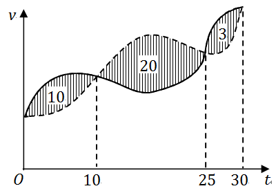

# 2017 年全国硕士研究生入学考试数学（二）试题

> 转换依据：吕剑瑞整理的原生 TeX；共用题已展开。来源与核对状态见根目录说明。

## 选择题

### 第 1 题

若函数$f(x) = \begin{cases}
  \frac{1 - \cos \sqrt{x}}{ax}, & x > 0 \\
                             b, & x \le 0
\end{cases}$在$x = 0$处连续，则（　）

A. $ab = \frac{1}{2}$．

B. $ab = - \frac{1}{2}$．

C. $ab = 0$．

D. $ab = 2$．

### 第 2 题

设二阶可导函数$f(x)$满足$f(1) = f(- 1) = 1$，$f(0) = - 1$，且$f''(x) > 0$，则（　）

A. $\int_{-1}^1 f(x)\,\mathrm{d}x > 0$．

B. $\int_{-1}^1 f(x)\,\mathrm{d}x < 0$．

C. $\int_{-1}^0 f(x)\,\mathrm{d}x > \int_0^1 f(x)\,\mathrm{d}x$．

D. $\int_{-1}^0 f(x)\,\mathrm{d}x < \int_0^1 f(x)\,\mathrm{d}x$．

### 第 3 题

设数列$\left\{x_n \right\}$收敛，则（　）

A. 当$\lim_{n \to \infty} \sin x_n = 0$时，$\lim_{n \to \infty} x_n = 0$．

B. 当$\lim_{n \to \infty} (x_n + \sqrt{\left| x_n \right|}) = 0$时，$\lim_{n \to \infty} x_n = 0$．

C. 当$\lim_{n \to \infty} (x_n + x_n^2) = 0$时，$\lim_{n \to \infty} x_n = 0$．

D. 当$\lim_{n \to \infty} (x_n + \sin x_n) = 0$时，$\lim_{n \to \infty} x_n = 0$．

### 第 4 题

微分方程$y'' - 4y' + 8y = \mathrm{e}^{2x}(1 + \cos 2x)$的特解可设为$y^* =$（　）

A. $A\mathrm{e}^{2x} + \mathrm{e}^{2x}\left(B\cos 2x + C\sin 2x \right)$．

B. $Ax \mathrm{e}^{2x} + \mathrm{e}^{2x}\left(B\cos 2x + C\sin 2x \right)$．

C. $A\mathrm{e}^{2x} + x\mathrm{e}^{2x}\left(B\cos 2x + C\sin 2x \right)$．

D. $Ax \mathrm{e}^{2x} + x\mathrm{e}^{2x}\left(B\cos 2x + C\sin 2x \right)$．

### 第 5 题

设$f(x,y)$具有一阶偏导数，且对任意的$(x,y)$，
都有$\frac{\partial f(x,y)}{\partial x} > 0$，$\frac{\partial f(x,y)}{\partial y} < 0$，则（　）

A. $f(0,0) > f(1,1)$．

B. $f(0,0) < f(1,1)$．

C. $f(0,1) > f(1,0)$．

D. $f(0,1) < f(1,0)$．

### 第 6 题

甲、乙两人赛跑，计时开始时，甲在乙前方$10$（单位：m）处，
图中实线表示甲的速度曲线$v = v_1(t)$（单位：m/s），虚线表示乙的速度$v = v_2(t)$，
三块阴影部分面积的数值依次为$10$、$20$、$3$，计时开始后乙追上甲的时刻记为$t_0$（单位：s），
则（　）

A. $t_0 = 10$．

B. $15 < t_0 < 20$．

C. $t_0 = 25$．

D. $t_0 > 25$．

### 第 7 题

设$A$为$3$阶矩阵，$P = (\alpha_1,\alpha_2,\alpha_3)$为可逆矩阵，使得$P^{-1} AP = \begin{pmatrix}
  0 & 0 & 0 \\
  0 & 1 & 0 \\
  0 & 0 & 2
\end{pmatrix}$，则$A(\alpha_1 + \alpha_2 + \alpha_3) =$（　）

A. $\alpha_1 + \alpha_2$．

B. $\alpha_2 + 2\alpha_3$．

C. $\alpha_2 + \alpha_3$．

D. $\alpha_1 + 2\alpha_2$．

### 第 8 题

设矩阵$A = \begin{pmatrix}
  2 & 0 & 0 \\
  0 & 2 & 1 \\
  0 & 0 & 1
\end{pmatrix}$，$B = \begin{pmatrix}
  2 & 1 & 0 \\
  0 & 2 & 0 \\
  0 & 0 & 1
\end{pmatrix}$，$C = \begin{pmatrix}
  1 & 0 & 0 \\
  0 & 2 & 0 \\
  0 & 0 & 2
\end{pmatrix}$，则（　）

A. $A$与$C$相似，$B$与$C$相似．

B. $A$与$C$相似，$B$与$C$不相似．

C. $A$与$C$不相似，$B$与$C$相似．

D. $A$与$C$不相似，$B$与$C$不相似．

## 填空题

### 第 9 题

曲线$y = x\left(1 + \arcsin \frac{2}{x} \right)$的斜渐近线方程为 $\underline{\qquad}$．

### 第 10 题

设函数$y = y(x)$由参数方程$\begin{cases}
  x = t + \mathrm{e}^t \\
  y = \sin t
\end{cases}$确定，则$\left.\frac{\mathrm{d}^2y}{\,\mathrm{d}x^2}\right|_{t=0} =$ $\underline{\qquad}$．

### 第 11 题

$\int_0^{+\infty} \frac{\ln(1 + x)}{(1 + x)^2}\,\mathrm{d}x =$ $\underline{\qquad}$．

### 第 12 题

设函数$f(x,y)$具有一阶连续偏导数，且$\mathrm{d} f(x,y) = y\mathrm{e}^y \,\mathrm{d}x + x(1 + y) \mathrm{e}^y \,\mathrm{d}y$，$f(0,0) = 0$，
则$f(x,y)=$ $\underline{\qquad}$．

### 第 13 题

$\int_0^1 \,\mathrm{d}y \int_y^1 \frac{\tan x}{x}\,\mathrm{d}x =$ $\underline{\qquad}$．

### 第 14 题

设矩阵$A = \begin{pmatrix}
  4 & 1 & -2 \\
  1 & 2 & a \\
  3 & 1 & -1
\end{pmatrix}$的一个特征向量为$\begin{pmatrix}
  1 \\
  1 \\
  2
\end{pmatrix}$，则$a =$ $\underline{\qquad}$．

## 解答题

### 第 15 题（10 分）

求极限$\lim_{x \to 0^+} \frac{\int_0^x \sqrt{x - t} \mathrm{e}^t \,\mathrm{d}t}{\sqrt{x^3}}$．

### 第 16 题（10 分）

设函数$f(u,v)$具有$2$阶连续偏导数，$y = f(\mathrm{e}^x,\cos x)$，求$\frac{\,\mathrm{d}y}{\,\mathrm{d}x}\big|_{x = 0}$，$\frac{\mathrm{d}^2y}{\,\mathrm{d}x^2}\big|_{x = 0}$．

### 第 17 题（10 分）

求$\lim_{n \to \infty} \sum_{k = 1}^n \frac{k}{n^2} \ln \left(1 + \frac{k}{n} \right)$．

### 第 18 题（10 分）

已知函数$y(x)$由方程$x^3 + y^3 - 3x + 3y - 2 = 0$确定，求$y(x)$的极值．

### 第 19 题（11 分）

设函数$f(x)$在区间$[0,1]$上具有二阶导数，且$f(1) > 0$，$\lim_{x \to 0^+} \frac{f(x)}{x} < 0$．证明：

（1）方程$f(x) = 0$在区间$(0,1)$内至少存在一个实根．

（2）方程$f(x)f''(x) + \left(f'(x) \right)^2 = 0$在区间$(0,1)$内至少存在两个不同实根．

### 第 20 题（11 分）

已知平面区域$D = \left\{(x,y)|x^2 + y^2 \le 2y \right\}$，计算二重积分$\iint_D (x + 1)^2 \,\mathrm{d}x\,\mathrm{d}y$．

### 第 21 题（11 分）

设$y(x)$是区间$\left(0,\frac{3}{2} \right)$内的可导函数，且$y(1) = 0$．
点$P$是曲线$L:y = y(x)$上的任意一点．$L$在$P$处的切线与$y$轴相交于点$\left(0,Y_p\right)$，
法线与$x$轴相交于点$\left(X_p,0 \right)$，若$X_p = Y_p$，求$L$上点的坐标$(x,y)$满足的方程．

### 第 22 题（11 分）

设$3$阶矩阵$A= (\alpha_1,\alpha_2,\alpha_3)$有$3$个不同的特征值，
且$\alpha_3=\alpha_1\text{+}2\alpha_2$．

（1）证明：$r(A) = 2$；

（2）若$\beta =\alpha_1\text{+}\alpha_2\text{+}\alpha_3$，求方程组$Ax = \beta$的通解．

### 第 23 题（11 分）

设二次型$f(x_1,x_2,x_3) = 2x_1^2 - x_2^2 + ax_3^2 + 2x_1x_2 - 8x_1x_3 + 2x_2x_3$
在正交变换$x = Qy$下的标准型为$\lambda_1 y_1^2 + \lambda_2 y_2^2$，求$a$的值及一个正交矩阵$Q$．
